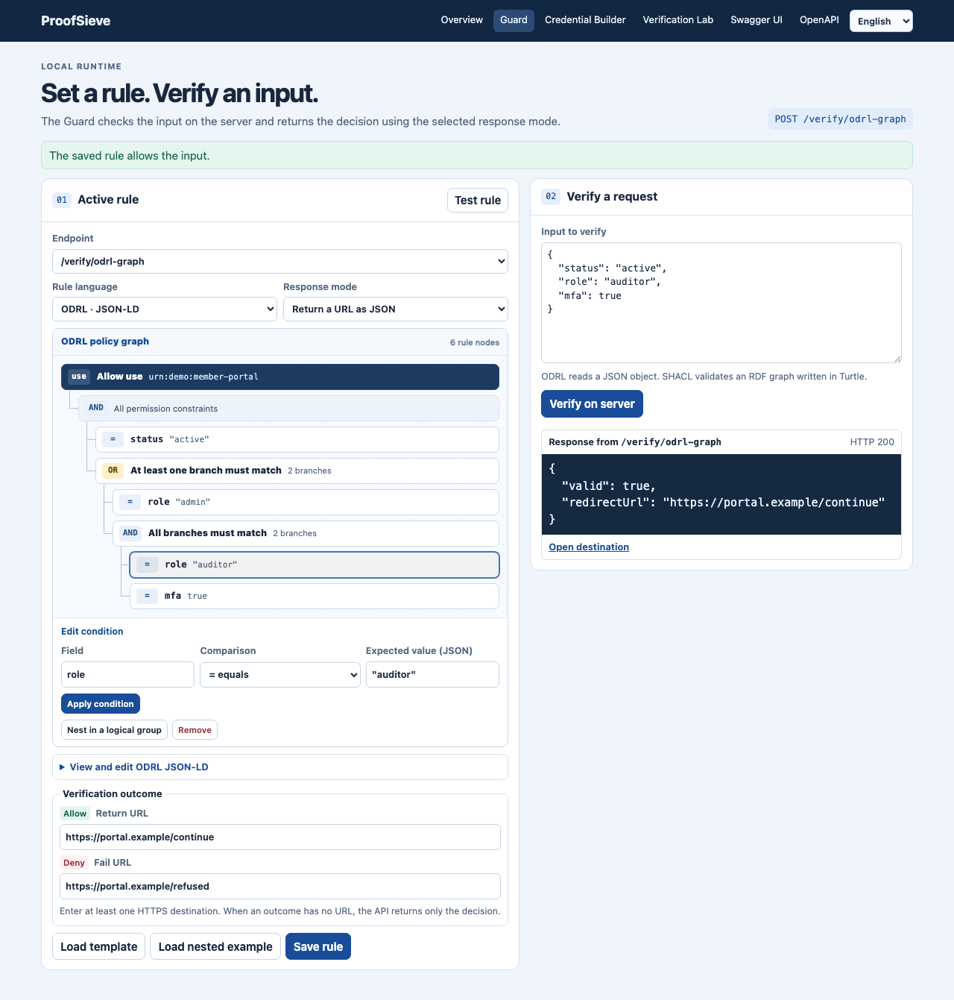
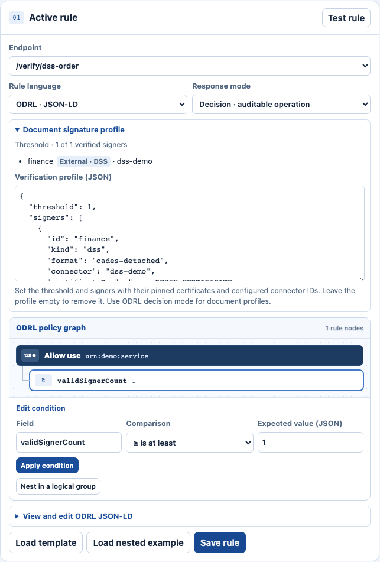
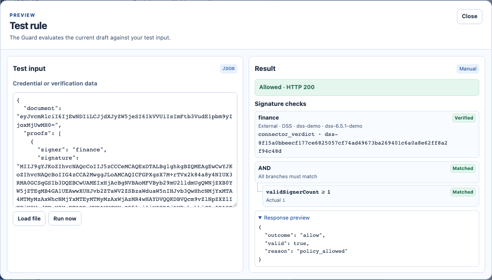
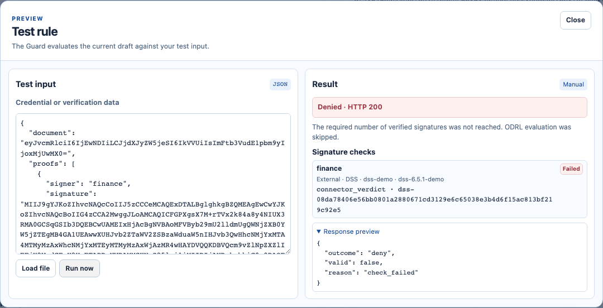
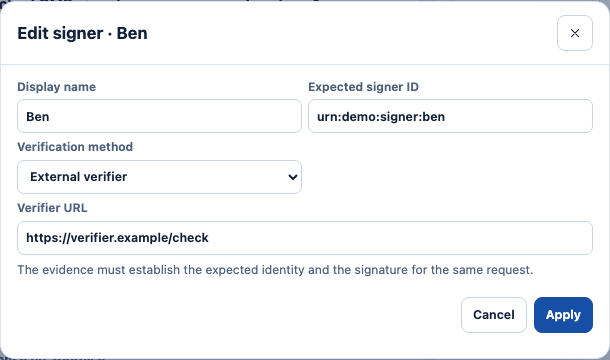
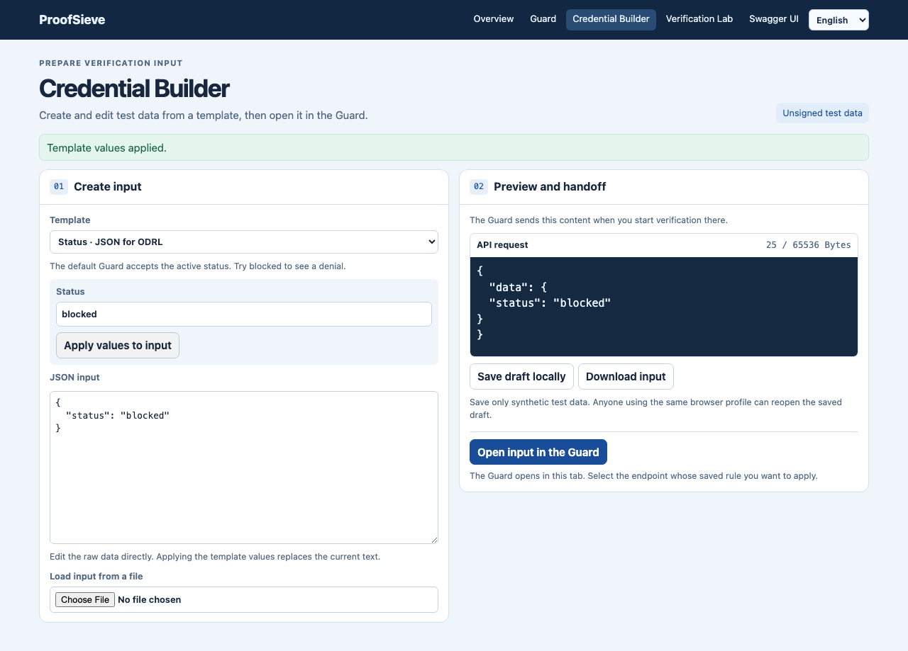
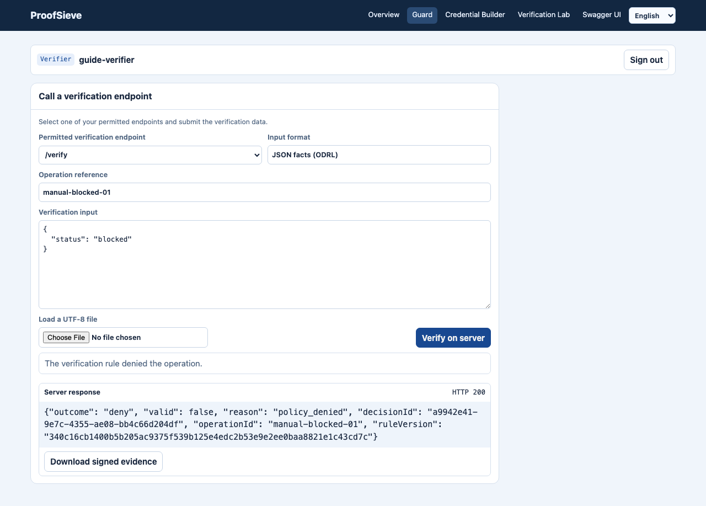
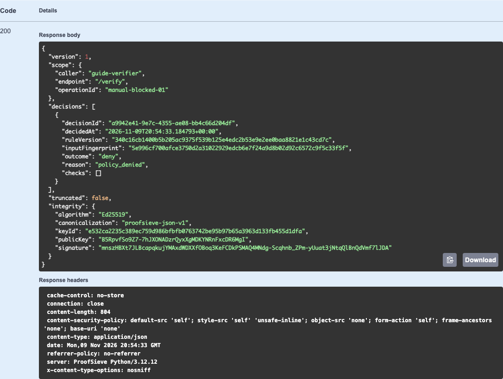

# ProofSieve

**A configurable credential verification and policy decision service**

ProofSieve evaluates ODRL or SHACL rules at configurable endpoints. It verifies signed credentials and documents against configured trust settings and supports wallet presentations through EUDI and Credo verifier adapters. It can record decisions, export signed evidence and report forwarding outcomes. The workspace includes Guard, Credential Builder, Verification Lab and Swagger UI in German and English.

## ProofSieve in action

### Build an ODRL policy and set its result URLs

[](docs/images/guard-policy-urls.png)

1. In **Guard**, select **Load nested example** to create a draft for `/verify/odrl-graph`.
2. Select the `role = "reviewer"` node in the nested **AND** group. Change **Expected value (JSON)** to `"auditor"` and select **Apply condition**. The rule now requires an active status and either an admin role or an auditor role with MFA.
3. Set **Response mode** to **Return a URL as JSON**. Enter `https://portal.example/continue` in **Return URL** and `https://portal.example/refused` in **Fail URL**. Select **Save rule**.
4. Under **Input to verify**, paste `{"status":"active","role":"auditor","mfa":true}` and select **Verify on server**. Repeat with `"mfa":false`.

| Auditor input | Server response |
| --- | --- |
| MFA enabled | HTTP 200 with `{"valid":true,"redirectUrl":"https://portal.example/continue"}` |
| MFA disabled | HTTP 200 with `{"valid":false,"redirectUrl":"https://portal.example/refused"}` |

The calling application receives the selected URL in JSON. To change the asset IRI shown at the root of the graph, open **View and edit ODRL JSON-LD** and edit `permission[0].target`. The result URLs are separate endpoint settings.

### Verify a signed document with a live external service

This example runs an actual DSS HTTPS bridge and verifies a detached CAdES signature against a disposable test CA. From the checkout, use the [local Python environment](#run-locally-from-a-checkout), Maven, and JDK 25.

```sh
.venv/bin/python examples/acceptance/dss/guard_demo.py --java-home "$JAVA_HOME"
```

The demo prints the Guard URL and the private folder containing the configuration and test inputs. The operator enters the verifier's HTTPS URL in `connectors.dss-demo.url` in `checks.json`. Guard loads that file through `--checks-config`. This run used port `50680`. The demo generates the actual port and TLS CA path for each run.

```json
{
  "version": 1,
  "connectors": {
    "dss-demo": {
      "kind": "dss",
      "url": "https://127.0.0.1:50680/validate",
      "allowedNetworks": ["127.0.0.1/32"],
      "caFile": "/absolute/path/to/tls-trust.pem",
      "bearerEnv": "PROOFSIEVE_ACCEPTANCE_DSS_TOKEN",
      "profileVersion": "dss-6.5.1-demo"
    }
  }
}
```

1. Open the printed Guard URL and sign in using the token in `admin.token`. Create `/verify/dss-order` and choose **ODRL · JSON-LD** and **Decision · auditable operation**.
2. Open **Document signature profile** and paste `verification-profile.json`. The signer entry pins the test certificate and sets `"kind": "dss"`, `"format": "cades-detached"`, and `"connector": "dss-demo"`. The connector ID resolves to the URL above.
3. In the ODRL graph, edit the condition to **Field** `validSignerCount`, **Comparison** `≥ is at least`, **Expected value (JSON)** `1`. Select **Apply condition** and **Save rule**. The verification profile selects the service and the ODRL rule evaluates the verified signer count.

[](docs/images/guard-dss-profile.png)

Load `original.json` or `modified.json` in **Input to verify**, enter a distinct **Operation reference**, and select **Verify on server** to record each decision. The screenshots show **Test rule → Run now**, which displays the live DSS check and the policy trace when the signature threshold is met.

| Original order | Modified order with the same signature |
| --- | --- |
| [](docs/images/guard-dss-allow.png) | [](docs/images/guard-dss-deny.png) |
| HTTP 200 · `allow` · `policy_allowed` | HTTP 200 · `deny` · `check_failed` |

Press Enter in the demo terminal to stop both services and remove the temporary files. [Connector configuration and bridge contract](docs/DOCUMENT-CHECKS.md#configure-connectors-as-an-operator)

### Set a verifier URL in the Verification Lab

In **Two of three signatures**, select **Ben**, choose **External verifier**, and enter the **Verifier URL**. The Lab simulates this check using example results.

[](docs/images/lab-verifier-url.png)

### Verify a request and export signed evidence

| Credential Builder | Guard | Swagger UI |
| --- | --- | --- |
| [](docs/images/builder-handoff.png) | [](docs/images/guard-denied.png) | [](docs/images/swagger-evidence.png) |
| Prepare a test input and open it in Guard. | Verify the input with a saved decision rule. | Inspect and download signed evidence for the same decision. |

[Follow the decision and evidence example in the user guide](docs/MANUAL.md).

## Current limits for company deployments

- **Document size.** Document verification accepts up to 64 KiB of raw document bytes. The complete HTTP request, including Base64 encoding and any detached proofs, is limited to 96 KiB. [Document verification](docs/DOCUMENT-CHECKS.md)
- **Wallet and trust scope.** Wallet verification covers the documented profiles. Full EU trust-list integration, wallet conformance testing and establishing qualified status under eIDAS remain outside the current release scope. [Wallet interoperability](docs/WALLET.md#interoperability-boundary) · [Trust services](docs/PROOF-BUNDLES.md#trust-service-integration-boundary)

## Run locally from a checkout

From the repository root, use Python 3.10 or newer. The commands below use Python 3.12.

```sh
python3.12 --version
python3.12 -m venv .venv
.venv/bin/python -m pip install .
.venv/bin/proofsieve
```

Open the [local workspace](http://127.0.0.1:4180/apps/). One process serves the workspace and its tools.

| App | Local path | Purpose |
| --- | --- | --- |
| Guard | [`/apps/guard/`](http://127.0.0.1:4180/apps/guard/) | Configure rules, endpoints and outcomes, and send actual verification requests. |
| Credential Builder | [`/apps/builder/`](http://127.0.0.1:4180/apps/builder/) | Author and export unsigned JSON test inputs or RDF Turtle. Pass the text to the Guard in the current tab. |
| Verification Lab | [`/apps/lab/`](http://127.0.0.1:4180/apps/lab/) | Explore the ten worked examples with synthetic check outcomes. |
| Swagger UI | [`/apps/api-docs/`](http://127.0.0.1:4180/apps/api-docs/) | Inspect scoped API contracts, send requests and download signed evidence when enabled. |

Select **English** in the language menu to follow the instructions below. The apps share this preference in the same browser.

Open the [EUDI PID example in the Builder](http://127.0.0.1:4180/apps/builder/?example=eudi-pid-sd-jwt) to inspect the source data and run the example rule on the server. The template selector also offers mdoc, selective disclosure, W3C VC and X.509 samples. See the [example sources, test results and verification boundaries](examples/credentials/README.md).

The Guard has two read-only endpoints for signed EUDI samples on the operator listener. In a protected workspace, the verifier needs a grant for the selected endpoint. Select **Verify on server** with the original or tampered input. ProofSieve verifies the issuer signature and claim integrity before applying ODRL. [SD-JWT VC](http://127.0.0.1:4180/apps/guard/?endpoint=/verify/demo/eudi-sd-jwt) · [mdoc](http://127.0.0.1:4180/apps/guard/?endpoint=/verify/demo/eudi-mdoc) · [Trust configuration and test cases](examples/signed/README.md)

In Guard, use an administrator identity when access control is enabled. Select an existing endpoint or choose **+ Create an endpoint** and enter a permitted path such as `/verify/account`. Paths start with `/verify` and may add segments using ASCII letters, digits, underscores and hyphens. Choose ODRL or SHACL, select **Load template**, edit the rule and choose **Save rule**. Test input from Credential Builder fills the input field when its format matches the selected rule. Choose **Verify on server** to submit the input to the selected endpoint.

Each endpoint has its own rule, response mode and URL settings. The installed command stores rules in `$XDG_STATE_HOME/proofsieve/rule.json`, defaulting to `~/.local/state/proofsieve/rule.json`. Running the module from a source checkout uses `instance/rule.json`. Use `--state` to choose a state file or `--port` to change the listener port. Existing single-rule state loads under `/verify`.

The default endpoint returns `true` for a JSON object whose `status` is `active`.

```sh
curl -sS http://127.0.0.1:4180/verify \
  -H 'Content-Type: application/json' \
  -d '{"data":{"status":"active"}}'
```

### Response modes

| Mode | Policy approval | Policy refusal |
| --- | --- | --- |
| Boolean (`boolean`) | HTTP 200 with JSON `true` | HTTP 200 with JSON `false` |
| Guard (`guard`) | HTTP 200 with JSON `true` | HTTP 403 with JSON `false` |
| URL response (`url`) | HTTP 200 with `valid: true` and `redirectUrl` from `returnUrl`, if set | HTTP 200 with `valid: false` and `redirectUrl` from `failUrl`, if set |
| Recorded decision (`decision`) | HTTP 200 with `outcome: "allow"`, operation and decision IDs, and rule version | HTTP 200 for a standard `deny`, HTTP 403 for wallet or forwarding refusal, and HTTP 503 for `indeterminate` |

In URL response mode, set at least one of `returnUrl` and `failUrl` to an absolute HTTPS URL without credentials. Use an empty string for a branch without a destination. These fields and `responseMode` are application settings stored alongside the policy. The ODRL policy defines the decision conditions. The API exposes the URL for the matching branch as `redirectUrl` and leaves navigation to the caller.

Set `returnUrl` to `https://app.example/accepted` and `failUrl` to `https://app.example/denied` to get responses like these.

```json
{"valid":true,"redirectUrl":"https://app.example/accepted"}
```

```json
{"valid":false,"redirectUrl":"https://app.example/denied"}
```

When the matching branch has no URL, the object contains just `valid`. An invalid request envelope returns HTTP 400 with an error object. In boolean, guard and URL modes, a rejected signed credential returns HTTP 403 with `stage: "credential"` and `code: "credential_rejected"` before policy evaluation. This response has no `redirectUrl`. In decision mode, credential rejection is recorded with reason `credential_rejected`.

The decision mode requires a configured evidence store, an authenticated caller and an opaque `operationId` next to `data`. Use 1–128 characters, starting with an ASCII letter or digit and continuing with ASCII letters, digits, periods, underscores, colons or hyphens. The relying application checks the outcome against the pending operation and consumes its approval once. It keeps the operation blocked on a technical failure. See the [company reference case](examples/company/README.md) and [deployment boundary](docs/DEPLOYMENT.md).

A decision endpoint with [server-side forwarding](docs/FORWARDING.md) adds delivery status. Its responses distinguish an approval acknowledged by the receiver, a policy refusal and a delivery failure.

Open [Swagger UI](http://127.0.0.1:4180/apps/api-docs/) on the operator listener to inspect and exercise the verification API. With authentication enabled, enter a ProofSieve token or a Keycloak service access token to load only its permitted paths. Open an operation and use **Try it out** with a test payload. Recorded-decision paths require `operationId`. The console can also download the same scoped specification for integration tooling.

The machine-readable contract is available at [OpenAPI JSON](http://127.0.0.1:4180/openapi.json). The [repository template](openapi.json) describes the generic operation. The live document specializes the body and result for each saved endpoint.

### Edit an ODRL rule as a graph

The Guard draws the permission, the action and target, and its nested logical groups as a connected tree. Select a node to change a comparison, add a condition, or nest a group. Changes update the same draft in the JSON-LD editor. Edits to the JSON-LD update the tree when the draft fits the supported profile. Use **Save rule** to activate it on the server. [Open a nested example as a new draft](http://127.0.0.1:4180/apps/guard/?example=nested)

Use **Test rule** to preview the current draft. Paste or load a credential or test file on the left. For document profiles, select **Run now** to start the check, which may contact a configured verification service. The right pane shows the decision, available ODRL trace and configured response. The preview leaves the saved rule and forwarding destination untouched.

The ODRL editor supports one permission to use a fixed target, typed top-level field comparisons and nested `and`, `or` and `xone` groups. The SHACL editor supports inline Turtle with explicit target nodes, direct property paths, and `hasValue`, count, datatype and node-kind constraints. An input must contain the targeted nodes. See [the Basic Guard profile](docs/ODRL-PROFILE.md#basic-guard-profile).

## Open the Verification Lab

Open the [Verification Lab](http://127.0.0.1:4180/apps/lab/) for ten worked examples, including 2-of-3 signer approval. Each example includes an editor, a graph, and previews of the evidence and API response based on synthetic facts. The browser stores your drafts. Rule export contains the edited configuration and policy, and the shipped examples retain their original test cases.

To exercise actual signatures, certificate status and the optional DSS bridge, run the [acceptance suite](examples/acceptance/README.md).

## Documentation

- [Installation and user guide](docs/MANUAL.md)
- [Linux service deployment](deploy/README.md) and [deployment boundaries](docs/DEPLOYMENT.md)
- [Architecture and design](docs/CONCEPT.md), [application flows](docs/diagrams/README.md) and [Keycloak verification sequence](docs/diagrams/keycloak-verification-flow.puml)
- [Supported profiles and limitations](docs/STATUS.md)
- [Admin and verifier access](docs/ACCESS.md) and [server-side forwarding](docs/FORWARDING.md)
- [Wallet presentation verification](docs/WALLET.md) and [W3C VC profiles](docs/CREDENTIALS.md)
- [Proof bundles and signed evidence](docs/PROOF-BUNDLES.md)
- [Document signatures, seals and optional DSS](docs/DOCUMENT-CHECKS.md)
- [ODRL policy and example conventions](docs/ODRL-PROFILE.md)
- [Supplier approval example](examples/company/README.md), [worked examples](examples/README.md) and [2-of-3 signer approval](examples/01-two-of-three.json)

## Project structure

| Location | Responsibility |
| --- | --- |
| `proofsieve/__main__.py` | Command line and startup |
| `proofsieve/server.py` | Loopback HTTP API and application assets |
| `proofsieve/guard.py` | Rule configuration, storage and decision pipeline |
| `proofsieve/odrl.py`, `proofsieve/shacl.py` | Rule compilers and evaluation |
| `proofsieve/sd_jwt.py`, `proofsieve/mdoc.py` | Signed credential adapters |
| `apps/`, `examples/`, `tests/` | Browser applications, synthetic examples and tests |

Read [Contributing](CONTRIBUTING.md) and [Security](SECURITY.md) before submitting changes.

## License and warranty

ProofSieve's original code and documentation use [Apache License 2.0](LICENSE). [NOTICE](NOTICE) records the terms and attributions for bundled third-party materials.

Unless applicable law requires otherwise or the parties agree in writing, ProofSieve is provided **“AS IS”**, without express or implied warranties or conditions. Sections 7 and 8 of the [license](LICENSE) set out the disclaimer of warranty and limitation of liability.
