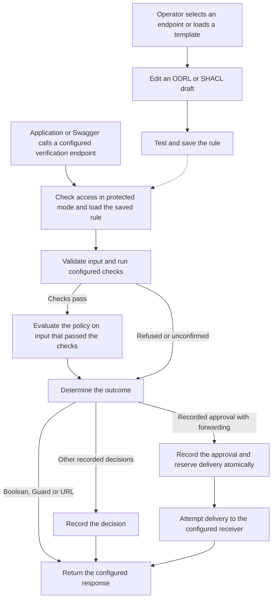

# Architecture and design

## Purpose

An operator receives credentials or other signed evidence from one or more issuers. The operator uses ProofSieve to decide whether a particular request can proceed. A valid result means that the input passed the applicable technical checks and satisfied the operator's configured policy for the requested action.

ProofSieve serves the Guard, Credential Builder, Verification Lab and Swagger UI from one runtime. The Guard configures and executes endpoint rules, the Builder creates test inputs, and the Lab explores example decisions. Integrations call the verification endpoints documented in OpenAPI. See the [supported profiles and limits](STATUS.md) and [runtime diagrams](diagrams/README.md).

## How it fits together

| Concern | Configuration |
|---|---|
| **Verification profile** | The endpoint selects its input format, trust material and configured checks. Signed input profiles provide verified facts to the policy. |
| **Policy** | ODRL evaluates typed facts. The supported SHACL Core subset validates inline RDF Turtle. |
| **Outcome** | The endpoint returns a boolean, guard status, configured URL or recorded decision. A recorded-decision endpoint can also deliver approved requests to a fixed HTTPS receiver. |

## Selection, checks and enforcement

1. The requested verification path selects a saved rule. In protected mode, the caller needs a grant for that exact path.
2. The configured profile validates the input. A signed profile checks proof integrity and configured trust before exposing claims. External checks use operator-configured connectors.
3. The Guard evaluates the policy. A required field comparison fails when the field is missing or mismatched. A document threshold counts distinct verified signers bound to the submitted document.
4. In recorded-decision mode, the Guard stores the outcome and rule version. For forwarding, it records approval and reserves delivery in one transaction before sending. It reports delivery status separately. [Forwarding contract](FORWARDING.md)

## Public response contract

| Mode | Granted | Refused or indeterminate |
|---|---|---|
| Boolean | HTTP 200 with JSON `true` | HTTP 200 with JSON `false` for a policy refusal. |
| Guard | HTTP 200 with JSON `true` | HTTP 403 with JSON `false` for a policy refusal. |
| Configured URL | HTTP 200 with `{"valid":true,"redirectUrl":"…"}` if an approval URL is configured. | HTTP 200 with `{"valid":false,"redirectUrl":"…"}` if a refusal URL is configured. Each branch returns only `valid` when its URL is unset. The caller handles navigation. |
| Recorded decision | HTTP 200 with a decision ID, operation reference and rule version. | The response records a denial or an indeterminate result. See the [response modes](../README.md#response-modes) for the HTTP status. |
| Server-side forwarding | HTTP 200 confirms that the configured HTTPS receiver acknowledged the approved request. | HTTP 403 for refusal, 409 for an operation conflict or expired evidence, 502 when the receiver rejects delivery, and 503 for an indeterminate check, unavailable evidence or unconfirmed delivery. [Delivery states](FORWARDING.md#interpret-the-result) |

Malformed requests and access failures use HTTP errors. In boolean, Guard and URL modes, a rejected signed credential returns HTTP 403 with `code: "credential_rejected"` before policy evaluation. A relying service reads the response body in boolean, URL and ordinary decision modes because HTTP 200 can carry a refusal.

## References

- [W3C ODRL Information Model](https://www.w3.org/TR/odrl-model/) and [Vocabulary](https://www.w3.org/TR/odrl-vocab/)
- [W3C Verifiable Credentials Data Model 2.0](https://www.w3.org/TR/vc-data-model-2.0/) and [SD-JWT VC](https://datatracker.ietf.org/doc/draft-ietf-oauth-sd-jwt-vc/)
- [OpenID4VP](https://openid.net/specs/openid-4-verifiable-presentations-1_0-final.html) and [OpenID4VC HAIP](https://openid.net/specs/openid4vc-high-assurance-interoperability-profile-1_0-final.html)
- [EUDI rules for PID and electronic attestations](https://eur-lex.europa.eu/eli/reg_impl/2024/2977/oj) and [ETSI EAA and PID presentation profile](https://portal.etsi.org/webapp/WorkProgram/Report_WorkItem.asp?WKI_ID=78836)
- [ETSI validation of qualified signatures and seals](https://portal.etsi.org/webapp/WorkProgram/Report_WorkItem.asp?WKI_ID=68047) and [EU Trusted Lists](https://digital-strategy.ec.europa.eu/en/policies/eu-trusted-lists)
- [OpenAPI Specification](https://spec.openapis.org/oas/latest.html) and [Swagger UI](https://swagger.io/open-source/swagger-ui/)
