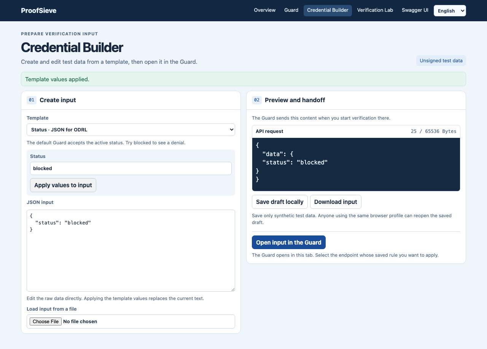
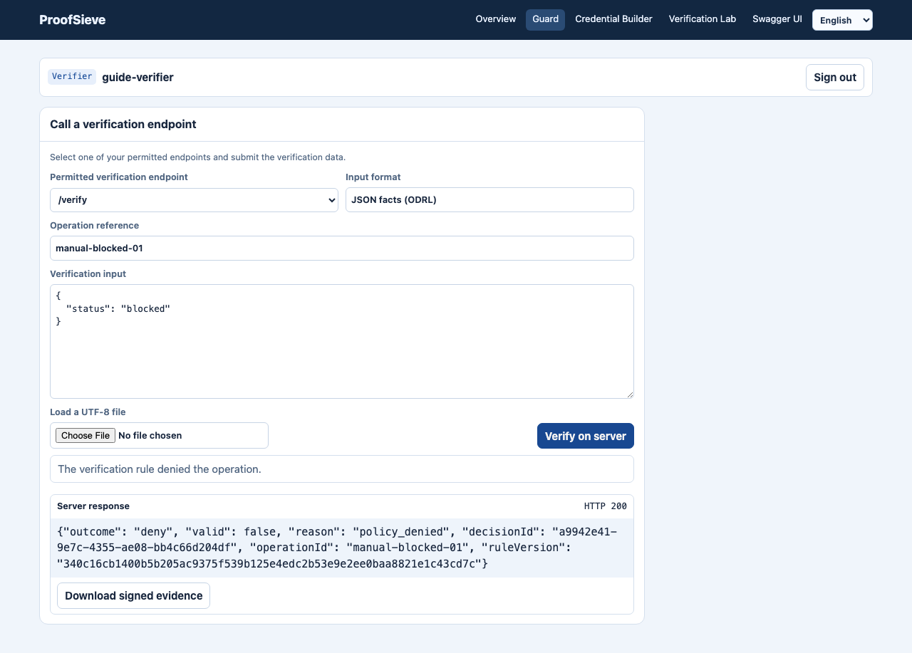
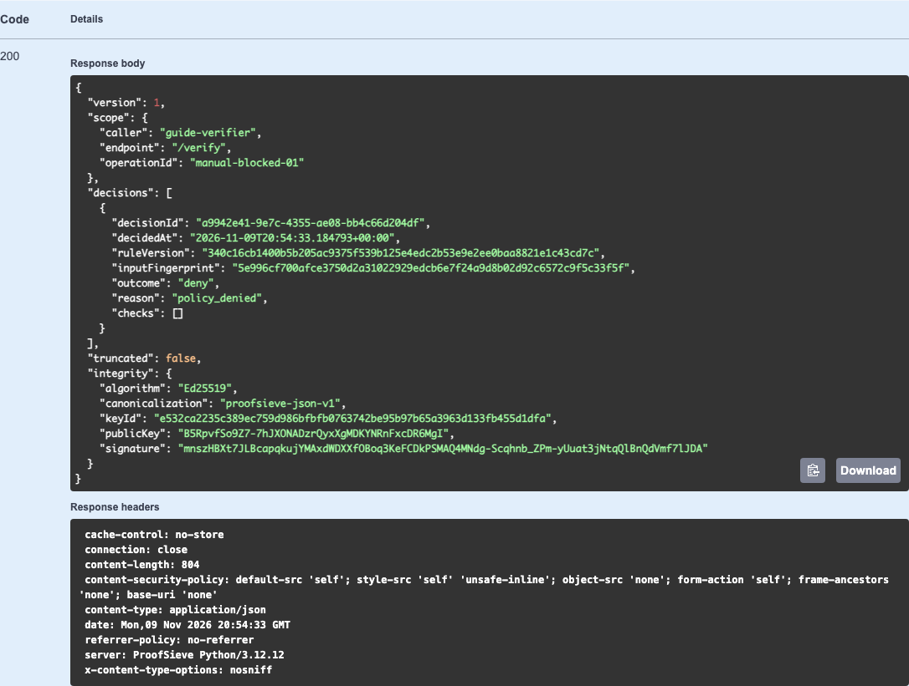

# ProofSieve user and integration guide

Use this walkthrough to install ProofSieve and run a complete synthetic case as an administrator and a verifier. You will activate a rule, pass two Builder inputs to the Guard and download the signed evidence for the refusal.

## Install the release wheel

Extract the verified release bundle into a new directory and open a terminal there. Check the file list and compare the checksums with the manifest from your trusted release channel. Use `shasum -a 256 -c SHA256SUMS` on macOS or `sha256sum -c SHA256SUMS` on Linux.

```sh
python3.12 -m venv .venv
.venv/bin/python -m pip install dist/proofsieve-0.5.0-py3-none-any.whl
.venv/bin/proofsieve --version
```

Use the wheel name shown in your release bundle. This guide uses Python 3.12. ProofSieve supports Python 3.10 and later. For the repository build and release checks, see [release acceptance](DEPLOYMENT.md#release-acceptance).

For a source checkout, follow the [local installation steps](../README.md#run-locally-from-a-checkout). Stop the local process before starting this protected exercise on the same port.

## Start a protected local workspace

The commands create a temporary directory for this exercise. The access file holds token digests. Keep the two token files private and use them only for this workspace.

```sh
umask 077
demo_dir=$(mktemp -d "${TMPDIR:-/tmp}/proofsieve-guide.XXXXXX")
.venv/bin/python - "$demo_dir" <<'PY'
from hashlib import sha256
import json
from pathlib import Path
import secrets
import sys

directory = Path(sys.argv[1])
principals = []
for role in ("admin", "verifier"):
    token = secrets.token_urlsafe(32)
    (directory / f"{role}.token").write_text(token + "\n", encoding="ascii")
    principals.append({
        "id": f"guide-{role}",
        "role": role,
        "tokenSha256": sha256(token.encode("ascii")).hexdigest(),
        "endpoints": ["/verify"],
    })
(directory / "access.json").write_text(
    json.dumps({"version": 1, "principals": principals}), encoding="utf-8"
)
PY

printf 'Exercise directory: %s\n' "$demo_dir"
.venv/bin/proofsieve --port 4180 \
  --auth-config "$demo_dir/access.json" \
  --state "$demo_dir/rules.json" \
  --evidence "$demo_dir/evidence.sqlite3" \
  --evidence-export
```

Open [the workspace](http://127.0.0.1:4180/apps/). The listener is on your machine. If port 4180 is in use, choose a free port and use it for all browser and API URLs in the exercise. Copy each token into its sign-in form from the corresponding file in your private editor. The browser holds each token in page memory. Sign in again after navigating to another app or reloading.

## Activate the rule as administrator

1. Open **Guard** and sign in with `admin.token`.
2. Select `/verify`. Use the default ODRL condition, which permits `status` equal to `"active"`. Select **Decision · auditable operation** under **Response mode**.
3. Select **Save rule**. The saved rule now records a decision for each operation reference.
4. Use **Sign out**. In a shared installation, the administrator distributes only the verifier's own token and endpoint information.

For ODRL, the rule graph and the JSON-LD editor edit the same draft. Apply or discard a pending condition edit before saving, testing the draft, or verifying the saved rule. **Test rule** previews the applied draft without activating it. Document profiles require an explicit **Run now** and may contact a configured verifier. Use saved verification endpoints only with an appropriate test operation, particularly when forwarding is enabled. If another administrator replaces the loaded rule, the Guard asks you to reload before verifying it.

## Verify the Builder inputs

1. Open **Credential Builder** and select **Status · JSON for ODRL**. Set **Status** to `active` and select **Apply values to input**. The JSON editor and API preview show the input to be checked. Select **Open input in the Guard**.
2. Sign in with `verifier.token` if prompted. The Guard loads the exact input at the permitted `/verify` endpoint. Enter `manual-active-01` as the operation reference and select **Verify on server**. Expect HTTP 200 with `valid: true` and `outcome: "allow"`.
3. Repeat from the Builder with status `blocked` and operation reference `manual-blocked-01`. Expect HTTP 200 with `valid: false` and `outcome: "deny"` in this endpoint's recorded-decision mode. Keep the denied response's `decisionId`.
4. Use **Download signed evidence** on the result for a direct download.





Builder templates create editable test input. An unsigned Builder input and a signed demo credential are separate. The EUDI PID templates offer **Open signed example in Guard** when the matching demo is enabled. This opens a new tab and preserves the Builder draft. The verifier needs a grant for that demo endpoint.

## Download and verify the same evidence in Swagger

1. Open **Swagger UI** from the app menu. Use `verifier.token` and **Load permitted endpoints**.
2. Expand **GET /evidence** and choose **Try it out**. Set `endpoint` to `/verify`, `operationId` to `manual-blocked-01` and `decisionId` to the exact ID from the Guard. Choose **Execute**.
3. Expect HTTP 200 and one decision with the matching ID, rule version and `outcome: "deny"`. Use **Download** in the response. The **Download OpenAPI JSON** action downloads the API contract.



To verify the downloaded file, obtain the public signing key from the operator over a trusted channel. For this local exercise, supply the downloaded filename and the existing exercise database path. The command reads the public key from that database.

```sh
.venv/bin/python - /path/to/downloaded-evidence.json /path/to/exercise/evidence.sqlite3 <<'PY'
import json
from pathlib import Path
import sys

from proofsieve.evidence import EvidenceStore, verify_evidence_export

bundle = json.loads(Path(sys.argv[1]).read_text(encoding="utf-8"))
store = EvidenceStore(Path(sys.argv[2]).resolve(strict=True))
if not verify_evidence_export(bundle, public_key=store.export_public_key):
    raise SystemExit("Evidence signature verification failed.")
print("Evidence signature verified.")
PY
```

Use the independent public key when verifying exports from another installation. The signature covers the export's recorded contents under that key. See [evidence scope and signing](PROOF-BUNDLES.md#export-a-decision).

## Integrate or operate the service

| Task | Where to continue |
| --- | --- |
| Call a verification endpoint from an application | Use the scoped OpenAPI contract, send the configured request format and consume the documented response. The [supplier case](../examples/company/README.md) demonstrates the complete signed integration. |
| Issue and validate service credentials | Use an opaque verifier token or [Keycloak service accounts](ACCESS.md#keycloak-service-accounts). Keycloak service grants authorize exact verification paths. |
| Present credentials from a wallet | Configure [EUDI or Credo](WALLET.md) and follow the [wallet session and evidence flow](diagrams/wallet-evidence-flow.png). |
| Verify documents or deliver approved requests | Use [local or DSS checks](DOCUMENT-CHECKS.md) and [forwarding](FORWARDING.md). Treat verification and delivery outcomes separately. |
| Run a persistent Linux service | Follow the [reference deployment](../deploy/README.md) and [deployment boundaries](DEPLOYMENT.md). Keep site-specific files and credentials in your private deployment. |

To end the local exercise, use **Clear token** in Swagger and **Sign out** in any open Guard tab. Stop ProofSieve with **Ctrl+C** in its terminal. Remove the temporary exercise directory when you no longer need its synthetic results.
