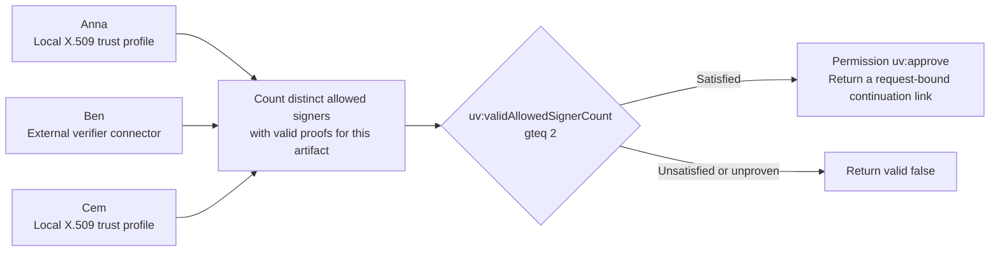

# ODRL policy and example conventions

The Verification Lab uses the illustrative namespace `https://proofsieve.example/vocab/` and the profile IRI ending in `/profiles/verification/v1`. Its examples model check results with synthetic facts. The server evaluates saved rules using the [Basic Guard profile](#basic-guard-profile).

## Policy model

- `uv:approve` is a proposed application action under `odrl:use`. It grants approval for the requested operation on the specified target when the constraints are satisfied. A published rule is selected within the authenticated integration scope.
- Each custom `uv:` left operand refers to a typed fact produced by a configured check. The check definition owns the fact's source and semantics. The example field `checks[].fact` connects it to the corresponding policy operand.
- `eq`, `gteq` and `lteq` use their standard ODRL meanings. These examples conjunct multiple constraints on one permission. See the Basic Guard profile for the logical groups supported by the running editor.
- The graph displays the policy and the check sources behind its operands. An HTTPS connector, its response mapping and the response or routing action are execution configuration referenced by the published rule version. A condition cannot introduce an arbitrary callable URL.
- An unavailable or unproven required fact cannot satisfy a permission. The execution evidence carries the reason and distinguishes refusal from an indeterminate result.

[W3C ODRL Information Model](https://www.w3.org/TR/odrl-model/) · [W3C ODRL Vocabulary](https://www.w3.org/TR/odrl-vocab/)

## Basic Guard profile

The running guard uses the narrower illustrative profile `https://proofsieve.example/profiles/basic/v1`. The context is the ODRL JSON-LD context plus `{"field":"https://proofsieve.example/facts/"}`. A rule is a `Set` with an absolute `uid` and one `permission` for `use` on a fixed absolute target IRI. Its nonempty `constraint` array is an implicit conjunction. A comparison reads one top-level JSON field via `field:<name>`. Supported operators are `eq`, `neq`, `gt`, `gteq`, `lt` and `lteq`. Equality compares values of the same JSON type. Ordering compares numbers. A missing or mismatched field makes its own comparison false. An alternative in an `or` group can still pass. The runtime evaluates this configured subset locally.

Each explicit logical group has one key, `and`, `or` or `xone`, with an inline array of at least two child conditions or groups. `and` requires all children, `or` at least one and `xone` exactly one. The editor and runtime allow up to eight levels below a top-level constraint and 128 group and condition nodes. This profile uses inline operands and leaves linked ODRL operands, `@list` wrappers and `andSequence` outside its scope. [ODRL logical constraints](https://www.w3.org/TR/odrl-model/#constraint-logical)

The Guard draws this structure as a tree and writes graph edits back to the same JSON-LD draft. Opening the graph leaves the draft text intact. Unsupported structures and integers outside the browser's safe integer range stay in the raw editor. The server supplies the saved policy text separately so opening a saved rule preserves those numbers. [Try a nested draft](http://127.0.0.1:4180/apps/guard/?example=nested)

The same endpoint can evaluate a SHACL Core rule on inline RDF Turtle. The current subset requires each explicit IRI target to occur as a subject in the data graph and uses direct IRI property paths. It supports `sh:hasValue`, `sh:minCount`, `sh:maxCount`, `sh:datatype` and `sh:nodeKind`. `sh:hasValue` compares RDF terms, including a literal's lexical form and datatype. For example, `1` and `+01` are distinct RDF terms even though both denote the same integer. [W3C SHACL](https://www.w3.org/TR/shacl/#HasValueConstraintComponent) · [RDF term equality](https://www.w3.org/TR/rdf11-concepts/#dfn-literal-term-equality)

## The 2-of-3 rule in both views

In **Quick configuration** in the Verification Lab, edit the example's allowed signer identities, validation methods, threshold `2` and outcome. Anna and Cem use local X.509 trust profiles. Ben uses an authenticated external connector. The configured method must prove the stable signer identity and bind the signature to the same artifact digest. Different certificates mapped to the same verified signer contribute one count.

With two proven signers the continuation link is returned. With one proven signer, including when that signer submitted two signatures, the permission remains unsatisfied. The example's link is a synthetic representation of a continuation reference. [Complete rule and cases](../examples/01-two-of-three.json)

## Reading the example files

| Field | Meaning |
|---|---|
| `appliesTo` | Format and type selection hints, plus any example selectors. |
| `checks` | Check identifier, kind, fact produced and example operator configuration. |
| `odrl` | JSON-LD policy expression using the proposed vocabulary. |
| `output` | Response mode and optional continuation or forwarding settings. |
| `cases` | Synthetic verified facts, expected validity and forwarding decision, and the reason to show in evidence. |
| `sources` | Specifications or primary documentation for the relevant mechanisms. |

The example cases show how the policy responds to simulated verifier results. For a runnable signature threshold with configured trust and real inputs, see [document signature checks](DOCUMENT-CHECKS.md#configure-a-two-of-three-endpoint).
