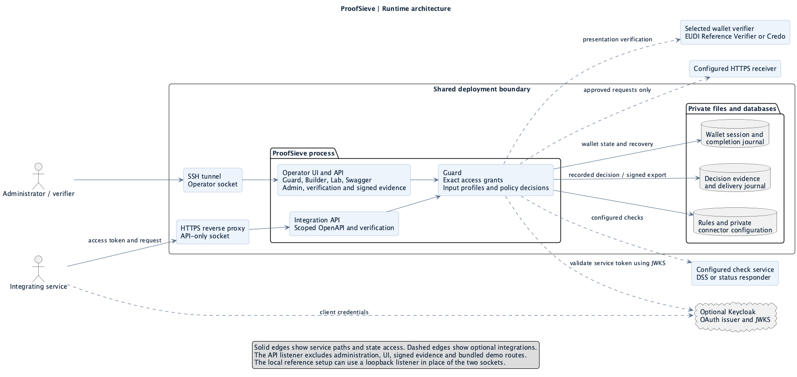
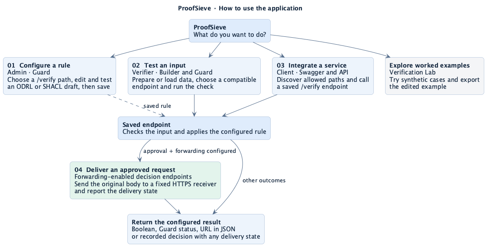

# ProofSieve application flows

These diagrams show how the workspace, verification API, state and optional integrations work together. A protected deployment uses separate admin and verifier identities with exact endpoint grants.

## Runtime architecture

The private operator path serves the workspace, administration and signed evidence. The HTTPS API path serves scoped OpenAPI and verification calls. Both reach the same configured Guard and state. A local installation can use a single loopback listener for the exercise in the [user and integration guide](../MANUAL.md). [PlantUML](runtime-architecture.puml) · [Deployment](../DEPLOYMENT.md)

## Application workflows

| What you want to do | Where to start | Diagram |
| --- | --- | --- |
| Configure and test a rule | In **Guard**, choose an endpoint, edit the ODRL graph or SHACL shapes, and open **Test rule**. Save explicitly to activate the draft. | [Diagram](browser-authoring-flow.png) · [PlantUML](browser-authoring-flow.puml) |
| Prepare an input and try a case | In **Credential Builder**, load or edit an input and send it to a compatible Guard endpoint. In **Verification Lab**, explore the worked cases with synthetic results. | [Diagram](builder-lab-flow.png) · [PlantUML](builder-lab-flow.puml) |
| Integrate an application | In **Swagger UI**, load the paths allowed for the caller's token. Use the selected endpoint's contract to send a verification request and interpret the response. | [Diagram](service-verification-flow.png) · [PlantUML](service-verification-flow.puml) |
| Verify a wallet presentation and recover evidence | Start a session at the configured endpoint, open the request in the wallet and complete the same operation. Download signed evidence for the recorded decision. | [Diagram](wallet-evidence-flow.png) · [PlantUML](wallet-evidence-flow.puml) |
| Deliver an approved request | Configure an HTTPS receiver for a decision endpoint. ProofSieve records the decision, reserves the delivery and sends the original request after approval. | [Diagram](approved-forwarding-flow.png) · [PlantUML](approved-forwarding-flow.puml) |

The [overview source](application-flows.puml) maps these paths. The supplier sequence shows Keycloak access and alternative verification methods for a recorded-decision integration. The acceptance suite exercises Keycloak with local credentials, DSS document checks and OCSP. The simpler loopback company example exercises SD-JWT verification and URL responses. [Sequence diagram](keycloak-verification-flow.png) · [PlantUML](keycloak-verification-flow.puml) · [Acceptance suite](../../examples/acceptance/README.md) · [Loopback company example](../../examples/company/README.md)

## Follow a flow in the application

- **First browser check** · Start in **Credential Builder** with JSON status data. Pass it to an ODRL Guard endpoint and verify `active` and `blocked` in turn against the default rule.
- **Rule authoring** · In **Guard**, use **Test rule** to trace the draft against a sample. Run **Verify on server** to exercise the saved endpoint and its configured response. A verification against a forwarding endpoint can deliver a real request.
- **Integration** · Use **Swagger UI** to see the payload and response for the actual saved endpoint. Signed inputs use the endpoint's configured trust material. The [company reference case](../../examples/company/README.md) provides a reproducible signed integration.
- **Delivery** · Follow the [forwarding configuration](../FORWARDING.md) and check the API's delivery state separately from the policy outcome. An approved operation can have an unconfirmed delivery.

An external verification service such as DSS can supply check results during evaluation. A forwarding receiver handles the approved operation after evaluation. The two services are configured independently.

Regenerate the diagrams from the repository root with `plantuml docs/diagrams/*.puml`.
